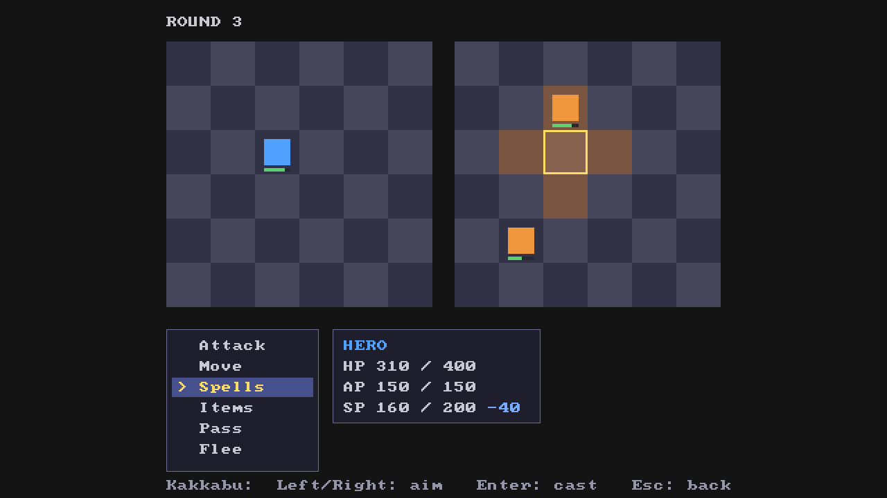
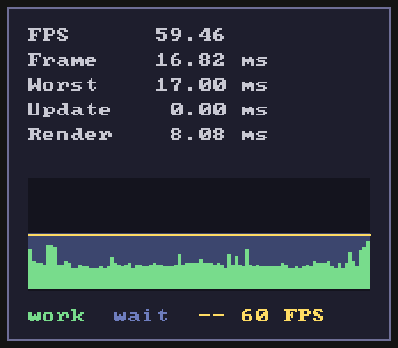

# URSAG: The Lost Scribes

A turn-based urban RPG, built in C++ with SDL3. This repository holds its battle system, which is still in progress.



*Early work in progress. The flat tiles and debug text are placeholders until art and angled camera are in.*

## Battle System

The hero and the enemies stand on two grids that face each other. Attacks and spells target tiles, not units, so where a unit stands decides what it can hit and what can hit it.

- **AP** pays for moving, attacking and items, and refills every turn.
- **SP** pays for spells, and only comes back through items.
- **Attacks** hit one tile anywhere on the enemy grid.
- **Spells** have shapes and land in the caster's own row. Instant spells hit right away. Wind-up spells mark their tiles and land a turn later.

Full rules are in [DESIGN.md](DESIGN.md).

## Current State

Working:
- Two 6x6 grids, with units starting on random tiles
- Moving, with a ghost preview of the move and its AP cost
- Attacks, HP and defeated units
- Instant and wind-up spells
- Enemies that attack on their turn
- Victory and defeat
- A performance overlay (F3) that tracks frame, update and render times

Next:
- Items
- Enemies that dodge and cast spells
- An angled camera, sprites and sound

## Controls

| Key          | Action |
|--------------|--------|
| Up / Down    | Choose a menu option |
| Enter        | Confirm |
| Esc          | Back / cancel |
| Arrow keys   | Plan a move, or aim an attack |
| Left / Right | Slide a spell along your row |
| F3           | Show or hide the performance overlay |

## Performance Overlay

Press F3 to show frame timings in the top-right corner. The overlay averages FPS, frame time, update time and render time over the last 96 frames, and shows the slowest frame.



## Building

The project builds on Windows with:
- A MinGW-w64 `g++` toolchain that includes `make`
- SDL3 MinGW development package, extracted to `C:\SDL\x86_64-w64-mingw32` (for the headers and libraries the build needs)

Build from the project folder:

```
make
```

This builds `main.exe` and copies `SDL3.dll` from the SDL folder next to it, so it's ready to run. `make clean` removes both.

## Project Structure

| File | What's in it |
|------|--------------|
| `src/main.cpp`  | Window setup and the main loop |
| `src/battle.*`  | Battle state, turns, input, and drawing the battle |
| `src/board.*`   | Grid layout and tile drawing |
| `src/unit.*`    | Units, spawning, and HP bars |
| `src/spell.*`   | Spell data and shapes |
| `src/hud.*`     | Menus, stats, hints and banners |
| `src/perf.*`    | Frame timing and the performance overlay |

## License

MIT. See [LICENSE](LICENSE).
